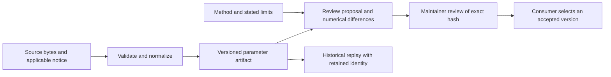

# Reviewing a calculation method

A result should identify what was calculated, from which inputs, under which
assumptions and with which retained evidence. A passing test proves the asserted
behavior; it does not independently validate a scientific model or provider bill.

Proposal generation, repository review, package publication and selection in a
consumer are separate steps. A scheduled import can propose a change; it must not
silently select it for users.

## Evidence to include

1. **Claim and scope.** Define the quantity, units, population and billing or
   environmental boundaries. State exclusions. Separate an estimate from a
   measurement, and a catalog observation from a normalized tariff.
2. **Provenance.** Supply a primary source where possible, exact bytes or a
   redistributable retained extract, immutable revision, content digest and
   applicable license/terms. Keep retrieval dates distinct from effective dates.
   An unknown effective date stays unknown.
3. **Method.** Explain the formula, operation order, rounding, model matching,
   cache treatment and missing-input behavior. Give the method an explicit
   revision when changing its numerical contract.
4. **Difference.** Show results before and after on representative synthetic
   inputs, including boundary cases. Report additions, removals, changed rates,
   explicit zeros, missing coverage and assumptions separately.
5. **Uncertainty and disagreement.** Retain conflicting evidence and explain
   whether sources are comparable. Low/high scenarios are not automatically
   statistical confidence intervals. Record unresolved questions visibly.
6. **Replay.** Keep the old artifact and method available. Verify old results
   still replay under their original identities, and explain every intentional
   new difference.

Use the methodology issue form to discuss a proposal and link the review in its
acceptance record. An exact hash ties review to content; the consuming application
still controls who may accept and activate it.

## Current evidence boundaries

The [pricing method](../calculations/pricing/METHOD.md) covers a bounded direct API
text-token contract. The [generated methodology](../calculations/pricing/proposal-2026-10-08/methodology.md)
records the retained source pin, candidate coverage and exclusions. It is not a
complete model catalog or a statement of present provider rates.

The [energy method](../calculations/energy/METHOD.md) preserves historical
token-to-energy assumptions and their original citations. Price ratios proxy
compute work; they are not measurements of the energy a particular request used.
The initial extraction does not select new environmental science. Critiques and
replacement-method proposals should address those assumptions directly.

The [legacy fixture explanation](../calculations/energy/fixtures/METHOD.md)
describes the synthetic model cases. Compatibility with those cases is useful
regression evidence; it is not independent environmental validation.

## Editing retained documents

The root `calculations/pricing/METHOD.md` and `calculations/energy/METHOD.md` are
inputs to retained proposal hashes. Their wording is part of review identity.
Statements about consumer adoption in retained method documents describe their
capture context, not current deployment state. Use the consuming product's own
documentation to establish adoption. Archive old proposal files unchanged; create
a new proposal for an intentional method-document or parameter change. Do not alter old bytes and keep an old hash.

Some historical provenance fields contain relative source paths from the original
implementation. Those are provenance labels, not dependencies on another checkout.
Current public implementation lives in `src/`; executable compatibility tests live
in `tests/`. Public integration and contribution guidance lives in `docs/`.

For artifact generation commands, source-manifest grammar and explicit overwrite
behavior, see [calculations/README.md](../calculations/README.md).
